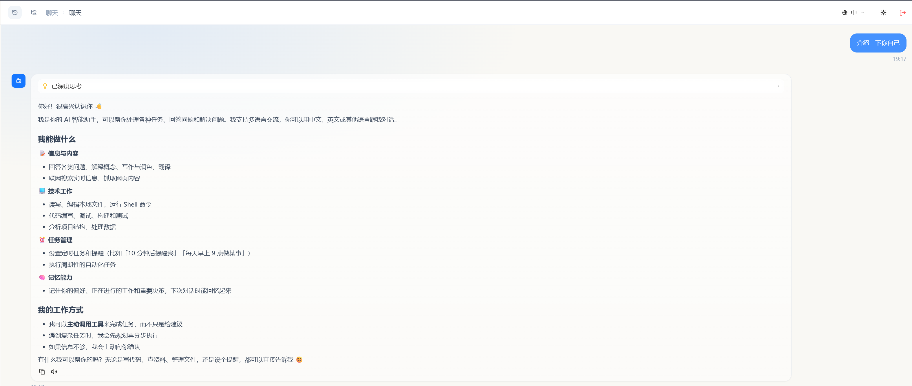
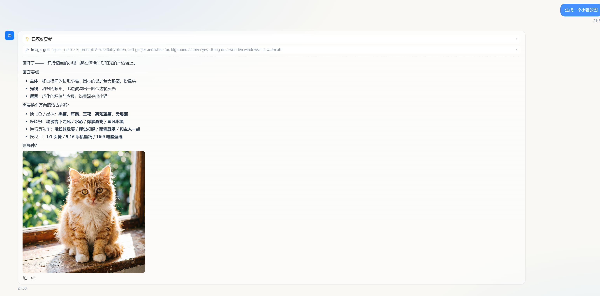

# GopherAgent

GopherAgent is a self-hostable personal AI agent. Beyond chatting, it can **proactively call tools** to get things done: web search and page fetching, reading/writing/editing local files, running commands, **image generation**, and **scheduled tasks** that run automatically on a plan.
With **long-term memory**, it remembers your preferences and important decisions and recalls them in later conversations.
It supports any OpenAI-compatible LLM (DeepSeek, OpenAI, Tongyi, Zhipu, Doubao, etc.), and sessions, models, and configuration can all be managed in the built-in web console.



---

## ✨ Implemented Capabilities

| Module | Description |
| :--- | :--- |
| Configuration Management | Config read/write, API key masking, `GET/POST /config` |
| Model Providers | Multiple OpenAI-compatible providers, credential management / custom vendors / primary model |
| Basic Chat | Multiple sessions, system prompts, context turn trimming |
| Image Generation | Text-to-image / image editing (text-to-image, image-to-image, multi-image fusion), multi-provider auto-routing + failure fallback, outputs saved to workspace and displayed in chat |
| Agent Tools | Function calling loop: shell, file read/write/edit, web fetch/search, memory retrieval, scheduled tasks |
| Streaming Chat | `POST /message` → `request_id`, `GET /stream` pushes `reasoning / delta / tool_start / tool_end / tool_media / done / stream_end` via SSE, supports `after_seq` resumption |
| Session Management | List / rename / pin / delete, paginated history, clear context, delete messages, per-session model and permissions |
| Long-term Memory | Markdown memory files (`MEMORY.md` + daily memories), hybrid vector + keyword retrieval |
| Persistence | GoFrame ORM + SQLite (`gopher_agent.db`) |

> Skills, knowledge base, channels, logs, workspace, and other interfaces are placeholder implementations to ensure the frontend loads correctly; they will be filled in as needed.

## 🚀 Quick Start

**Backend**

```bash
go run main.go
# -> database: .../gopher_agent.db
# -> listening on :9899
curl http://localhost:9899/api/health
```

On first launch, the database and default configuration are created automatically; the data directory can be specified with `GOPHER_DATA_DIR` (defaults to the current working directory).
Config priority: **`config.json` (optional, see below) > database (changed via console) > built-in defaults**.

**Frontend**

```bash
cd web && npm install
# web/.env.local
#   VITE_USE_MOCK=false
#   VITE_BACKEND_URL=http://localhost:9899
npm run dev     # http://localhost:5173
npm run build   # outputs web/dist/
```

CORS is enabled on the backend, so no Vite proxy is needed on the frontend.

## 🔧 Configuration

Configuration is centralized in the **GoFrame config file** `manifest/config/config.yaml` (the repo ships with defaults; keys are left empty). Priority: **environment variables > config file > code defaults**.

1. **Config file** `manifest/config/config.yaml`: all settings for models, provider keys, image generation, agent, Redis, etc. Changes made on the console "Config" page are **written back to this file** and take effect.
2. **Environment variables**: convert the config key to uppercase with underscores to **override** file values, e.g. `model` → `MODEL`, `web_port` → `WEB_PORT`, `redis_addr` → `REDIS_ADDR`. **Keys are recommended to be set here**:

   ```bash
   export MODEL=deepseek-v4-flash
   export DEEPSEEK_API_KEY=sk-...
   export REDIS_ENABLED=1
   export REDIS_ADDR=127.0.0.1:6379
   export REDIS_PASSWORD=...
   ```

> **Upgrade note**: Config stored in the SQLite `config` table in older versions (including API keys) is **automatically migrated** into `manifest/config/config.yaml` on first launch.
> **Do not commit keys**: it is recommended to `git rm --cached manifest/config/config.yaml` and add it to `.gitignore`, or inject via environment variables.

### Redis (optional)

Disabled by default; when not configured, all coordination state falls back to in-process memory, so **single-node deployments are completely unaffected**. When enabled, it is used for:
SSE event bus (cross-node send/receive/cancel across multiple instances), memory flush watermarks, scheduler distributed locks, and login failure rate limiting.

```yaml
# manifest/config/config.yaml
redis_enabled: true
redis_addr: 127.0.0.1:6379
redis_password: ""
redis_db: 0
redis_prefix: "gopher:"
```

Or override via environment variables (`REDIS_ENABLED` / `REDIS_ADDR` / `REDIS_PASSWORD` …).
It takes effect when `redis connected: <addr>` and `chat bus: redis (multi-node)` appear in the startup log; on connection failure, a warning is logged and it automatically degrades to memory.

## 🎨 Image Generation

The agent can call `image_gen` to generate an image from a description; it also supports using local files or URLs as input for **image-to-image** and **multi-image fusion**.
Outputs are saved to the `images/` directory in the workspace and displayed directly in the conversation (including history).



- **Multi-provider**: OpenAI, Gemini (Nano Banana), Volcano Ark (Seedream), Bailian (Qwen), MiniMax, and any OpenAI-compatible custom vendor
- **Auto-routing + failure fallback**: by default, the first configured provider is selected in the order `openai → gemini → doubao → dashscope → minimax`; on failure it automatically switches to the next one; when a specific model is specified, its native provider is preferred
- **Credential reuse**: by default, it reuses the keys configured for the chat model (`open_ai_api_key` / `gemini_api_key` / `ark_api_key` / `dashscope_api_key` / `minimax_api_key`), and can also be overridden individually with `image_api_key` / `image_api_base`
- **Parameters**: `prompt` (required), `image` (optional, input image for editing/fusion, string or array), `size` (`512` / `1K` / `2K` / `4K` or `WxH`), `aspect_ratio`, `quality` (`low` / `medium` / `high`, supported by some providers), `n`
- **Output retrieval**: `GET /api/media?path=...`, restricted to within the workspace to prevent directory traversal

Enable and select a provider in the console under "Config → Image Generation", or via the API:

```bash
curl -X POST http://localhost:9899/config -H "Content-Type: application/json" -d '{"updates":{
  "image_enabled": true,
  "image_provider": "auto",
  "image_model": "",
  "image_size": "1K",
  "image_max_per_call": 1
}}'
```

Related config keys: `image_enabled`, `image_provider`, `image_model`, `image_size`, `image_quality`,
`image_max_per_call`, `image_timeout_sec`, `image_fallback`, `image_output_dir`, `image_api_key`, `image_api_base`.
When not enabled, `image_gen` returns a clear prompt and does not affect other features.

## 🛠 Agent Tools

Chat runs a tool-calling loop: tool definitions (JSON Schema) are sent to the model along with the request; when the model returns `tool_calls`, they are executed locally,
`tool_start` / `tool_end` are pushed via SSE, and the result is sent back as a `tool` message, until the model gives a final answer (up to `agent_max_steps` steps).

| Tool | Description |
| :--- | :--- |
| `bash` | Run shell commands (PowerShell on Windows, bash on other platforms) |
| `read` / `write` / `edit` | Read (supports line ranges) / write / exact string replacement |
| `ls` | List directory contents |
| `web_fetch` | Fetch a webpage and convert to plain text (blocks loopback / internal addresses) |
| `web_search` | Web search (bocha / zhipu / qianfan) |
| `memory_search` | Hybrid retrieval of long-term memory and knowledge base (vector + keyword) |
| `memory_get` | Read a line range from memory / knowledge files |
| `image_gen` | Generate / edit images (text-to-image, image-to-image, multi-image fusion), multi-provider auto-routing and failure fallback |
| `scheduler` | Create / manage scheduled tasks (`once` / `interval` / `cron`) |

Related config: `agent_workspace`, `agent_max_steps` (default 30), `disabled_tools`,
`agent_permission_mode` (currently only recorded; full permission checks pending implementation), `web_search_*`.

> ⚠️ These tools can read/write local files, run commands, and access the network. Only deploy in a trusted environment.

### Scheduled Tasks

The `scheduler` tool and the background worker share the `scheduled_tasks` table:

- Types: `send_message` (writes to a session at the scheduled time) / `agent_task` (executed by the agent at the scheduled time and produces a result)
- Scheduling: `once` (`+10m` / ISO time), `interval` (seconds), `cron` (5 fields)
- The worker scans for due tasks every 10 seconds; `once` tasks are automatically disabled after execution

## 🧠 Long-term Memory

Memory is stored as Markdown in the workspace, with a searchable chunk index built in SQLite:

```
<workspace>/MEMORY.md            Long-term facts (injected into the system prompt each conversation turn)
<workspace>/memory/YYYY-MM-DD.md Daily memory (time-decayed by date)
<workspace>/knowledge/**.md      Knowledge base (when knowledge is enabled)
```

- **Chunking / vectors**: chunked by line with `memory_chunk_tokens` (500) / `memory_chunk_overlap` (50); OpenAI-compatible `/embeddings`
- **Indexing**: `memory_chunks` (includes `embedding` BLOB) + `memory_files` (file hash for incremental updates); on sync, updates are incremental by hash; on embedding failure, the old index is retained
- **Retrieval**: `score = vector_weight · vector cosine + keyword_weight · keyword`; daily files are further multiplied by a time decay (half-life `memory_half_life_days` days; `MEMORY.md` does not decay)
- **Writing**: the agent writes memory files with `write`/`edit`; when `memory_auto_flush` is enabled, a session summary is appended to today's memory every `memory_flush_turns` turns
- **Commands**: `/memory rebuild-index` (rebuild the index), `/memory flush` (summarize the current session into today's memory)
- **Embedding not configured**: retrieval automatically degrades to keyword-only mode; the feature remains usable

## 🗂 Directory Structure

```
GopherAgent/
├── main.go                    # Entry point (go run main.go)
├── config.example.json        # Config example (copy to config.json; the latter is git-ignored)
├── internal/
│   ├── cmd/cmd.go             # Startup, route registration, CORS
│   ├── store/sqlite.go        # SQLite connection and table creation
│   ├── controller/api/        # Console API
│   └── logic/
│       ├── config/            # Config storage + provider registry + credential resolution
│       ├── redisx/            # Optional Redis client (bus / watermark / lock / rate limiting)
│       ├── llm/               # OpenAI-compatible client (streaming + function calling + summarization)
│       ├── embedding/        # Multi-provider OpenAI-compatible embeddings
│       ├── tools/             # shell / file / web / memory / scheduler / image_gen
│       ├── imagegen/          # Image generation: multi-provider provider + auto-routing / failure fallback
│       ├── memory/            # File-based memory: chunking, hybrid retrieval, time decay
│       ├── paths/             # Agent workspace resolution
│       ├── scheduler/ + schedulerrun/   # Scheduled task storage and background worker
│       └── chat/              # Session/message persistence, agent loop, SSE Hub (memory/Redis)
└── image/                     # README screenshots
```
